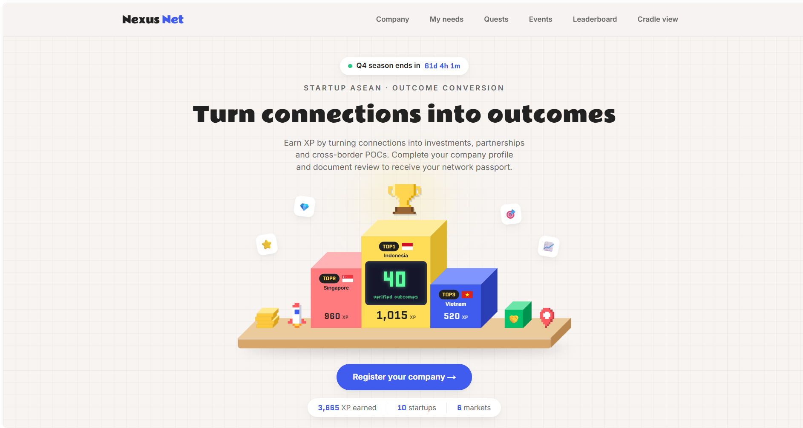

<div align="center">

# Nexus Net

**Turn ecosystem connections into measurable outcomes.**

Startups earn XP by turning connections into real outcomes. Gemma 4 generates their quests and verifies their proof, and Cradle sees the conversion funnel live.

[**Live demo →**](https://nexus-net-iota.vercel.app/)


<br />

<a href="https://nexus-net-iota.vercel.app/">
  
</a>

<sub>Built at <b>Hacktoberfest Hack Day KL</b>, 31 Oct 2026 · Category: <b>Best Use of Gemma 4</b></sub>

</div>

---

## Table of contents

- [The problem](#the-problem)
- [Features](#features)
- [How proof verification works](#how-proof-verification-works)
- [XP and levels](#xp-and-levels)
- [Tech stack](#tech-stack)
- [Getting started](#getting-started)
- [Architecture](#architecture)
- [Honesty notes](#honesty-notes)
- [License](#license)

---

## The problem

> **Problem statement #1: Outcome Conversion**
>
> *"How can Startup ASEAN successfully convert ecosystem connections into measurable outcomes, including investments, commercial partnerships, market expansion, and cross-border POCs?"*

Nexus Net turns that question into a game. Every connection becomes a quest, every quest needs proof, and every verified proof moves the startup, and the whole ecosystem, further up the funnel.

---

## Features

| | Feature | What it does |
|---|---|---|
| 🎯 | **AI quest generator** | Gemma 4 writes 5 personalised, mostly cross-border quests from the startup profile and the programme/event catalog. |
| 🔍 | **AI proof verification** | Upload a screenshot or document; Gemma 4 vision approves, rejects or flags it. Approval awards XP and counts as a verified outcome. |
| 🧭 | **Needs assessment** (`/needs`) | Fixed questions; code detects and ranks the startup's gaps; Gemma words each option. Any option can be added as a quest done by a talent. |
| 🪪 | **Company passport** (`/register`, `/profile`) | Onboarding identity check of a registration document. Issues a passport, never XP. |
| 🏆 | **Leaderboards** | Startups, countries and events, with a top-3 podium. |
| 📊 | **Cradle dashboard** (`/cradle`) | Funnel from connections to investments, outcomes by country, results by event. |
| 📅 | **Events calendar** (`/events`) | Public Kuala Lumpur events from Luma; subscribing earns bonus XP. |
| 👤 | **Demo login** | Pick a seeded startup on `/` (no real auth). |

---

## How proof verification works

There are two **separate** checks, and they are never mixed:

| | Company identity | Quest proof |
|---|---|---|
| **Where** | `/register` → `/profile` | `/quests` → **Submit proof** |
| **Upload** | Incorporation certificate or registry extract | Screenshot or document proving the quest |
| **Gemma checks** | Legal name, registration number, jurisdiction | Document type, parties, counterpart country, recent date, red flags |
| **Result** | Company passport | Verified quest + XP + Cradle funnel |
| **Grants XP?** | ❌ Never | ✅ Yes |
| **Test files** | `public/demo-evidence/` | `demo-assets/` |

Both offer a clearly labelled **Simulation (no AI)** mode for demos; live Gemma is the default. Event-calendar XP never counts as a verified outcome.

---

## XP and levels

| Quest type | XP | | Level | Total XP |
|---|---:|---|---|---:|
| Connect | 20 | | Connected | 0 |
| Meeting | 50 | | Engaged | 100 |
| Programme | 75 | | POC | 300 |
| POC | 150 | | Partnership | 600 |
| Partnership | 250 | | Funded | 1,000 |
| Funding | 400 | | | |

Levels are always derived from total XP, never stored. XP values come from this table, never from the model.

---

## Tech stack

- **Framework:** Next.js (App Router) + TypeScript
- **Styling:** Tailwind CSS
- **State:** Zustand, persisted to `localStorage`
- **Charts:** Recharts
- **AI:** Gemma 4 via `@google/genai` (Gemini API)

---

## Getting started

**1. Install**

```bash
npm install
```

**2. Configure.** Create `.env.local` (see `.env.example`):

```bash
GEMINI_API_KEY=your_key_here
GEMMA_MODEL=gemma-4-26b-a4b-it
```

**3. Run**

```bash
npm run dev
```

Open <http://localhost:3000>.

> [!TIP]
> Add `?demo=1` to the URL to skip Gemma and use canned quests and template wording, which is handy if the API is unreachable.

**Checks**

```bash
node --test tests/company_verification.test.mjs   # company route with a stubbed provider
npm run lint
npm run build
```

---

## Architecture

```
Browser (Next.js pages + Zustand store)
        │
        ▼
Server route handlers ──► Gemma 4 (Gemini API)
  /api/quests/generate
  /api/needs/analyze
  /api/proof/verify
  /api/company/verify
```

- **Client:** pages in `src/app`, components in `src/components`, game state in a persisted Zustand store (`src/store`). No database.
- **Server:** Gemma is only ever called from server route handlers, so the API key never reaches the browser.
- **Gemma calls** (`src/lib/gemma.ts`): JSON-only prompts, code fences stripped before parsing, one retry, then a readable error. Model output is validated before use.

---

## Honesty notes

- All seed data (startups, programmes, events, past quests), talent profiles and demo proof images are **fictional**.
- The `/events` calendar shows real public listings from Luma; nothing else uses real Startup ASEAN data.
- The needs-assessment questions are fixed, not AI-generated, and the gaps are found by code. Gemma only writes the wording.
- Gemma's confidence scores are not calibrated (they come back near 1.0), so approvals also require an `approved` decision plus sensible parties and document type.

---

## License

Released under the [MIT License](LICENSE).
